# WebWeave

用对话制作网页，在本地预览、修改并保存成品。

[](https://go.dev/)
[](LICENSE)

WebWeave 是一个本地运行的 AI 网页制作工作台。描述你想做的网站，上传参考图或需求文档，就可以让 AI 协助梳理需求、设计页面、编写代码，并在工作台中查看效果、继续调整。

适合制作个人主页、博客、产品展示页、活动页面和后台界面原型。生成的项目文件保存在本机，可以自行修改和使用。

## 可以用它做什么

- **从想法开始制作网页**：用自然语言说明用途、内容和风格，确认方案后生成可预览的页面。
- **对着页面提出修改**：选中组件或标记页面位置，把“这里需要调整”的具体位置带入对话。
- **检查不同屏幕效果**：在桌面、平板和手机尺寸间切换预览。
- **继续较长的任务**：自动整理较早的对话，保存任务进度；停止或重启后可以恢复未完成的工作。
- **让不同角色协作**：由主 Agent 协调设计、工程和质量检查，也可以选择某个角色直接对话。
- **保存自己的前端模板**：制作模板、检查效果，确认后保存到模板库。

## 效果展示

从创建对话到预览成品，下面展示 WebWeave 的实际使用界面。网页制作部分以一个名为“白纸”的简约风博客为例。

### 首页：查看任务与当前配置

仪表盘汇总任务状态，并展示当前模型、已启用工具和可用 Skills。从这里可以开始新的网页任务，也可以打开最近工作继续制作。

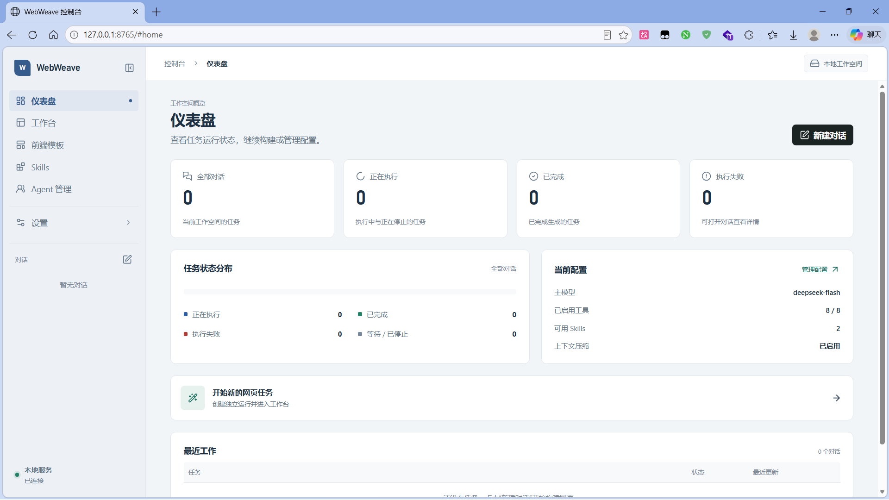

### 新建对话：描述你想做的网页

首次进入工作台时，点击“创建新对话”开始制作。

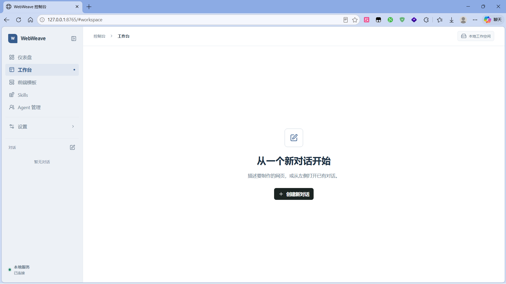

在输入框中描述网页用途、内容和风格，也可以上传参考资料，并选择本次任务使用的 Agent。

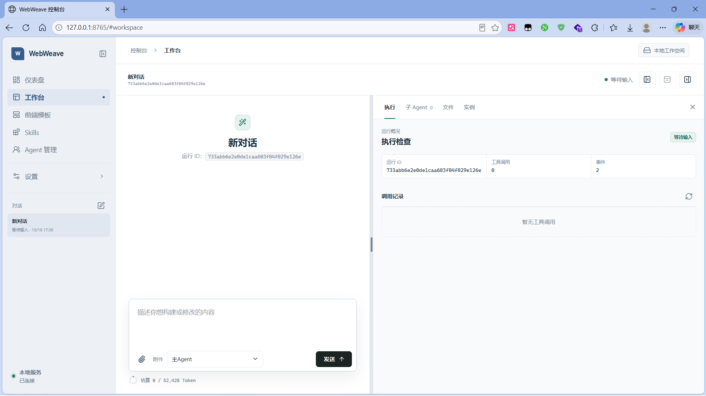

### 制作过程：在同一对话中查看交付并继续修改

对话中保留制作记录、交付说明和生成文件信息。可以收起右侧检查区，集中阅读回复，或继续提出修改要求。

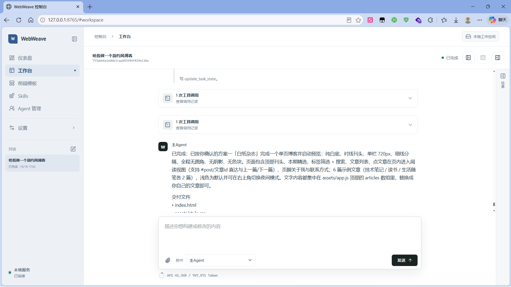

### 执行与协作：了解任务如何推进

“执行”页签展示工具调用状态和耗时，便于了解 AI 已经完成哪些步骤，以及问题出现在哪一步。

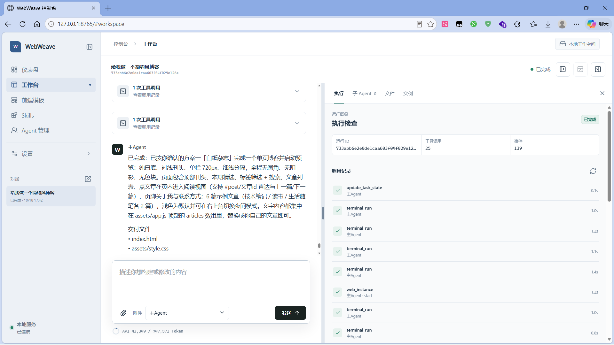

主 Agent 委派任务后，可以在“子 Agent”页签查看对应角色的独立会话。图中展示的是质量检查 Agent 对博客进行只读检查的过程。

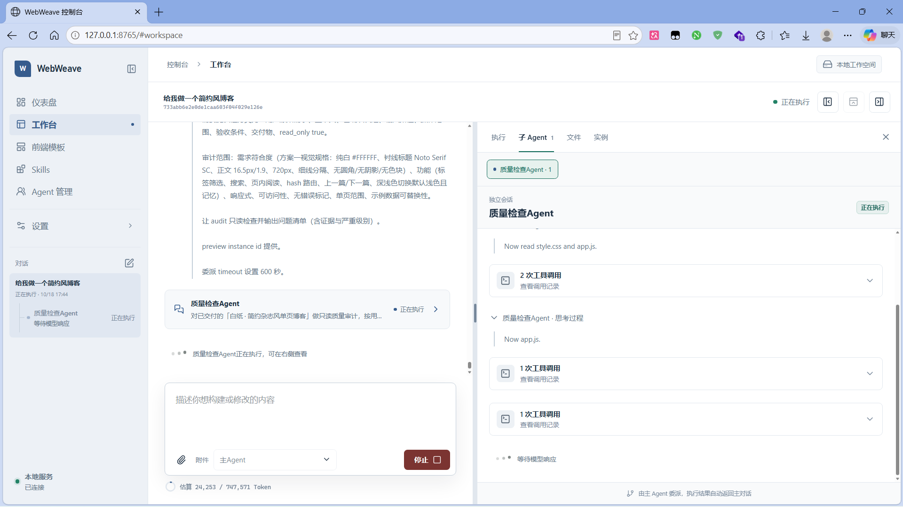

### 网页预览：直接操作生成的页面

网页启动后，在“实例”页签中查看和操作成品，也可以切换桌面、平板和手机尺寸。实例工具栏提供刷新、重启、停止和新窗口打开等操作。

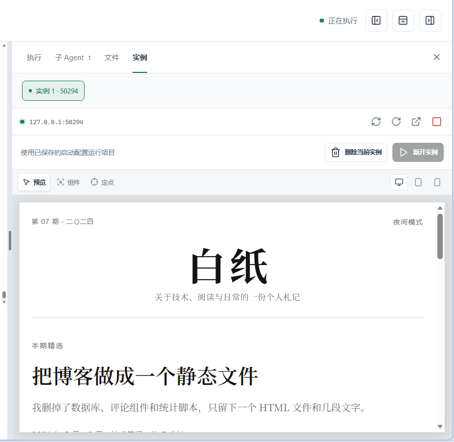

需要调整具体位置时，可以标记组件或添加定点评价，再将修改要求发送给 AI。右键菜单提供组件标记、预览刷新和模式切换等快捷操作；临时移动和隐藏仅用于当前预览，刷新后恢复。

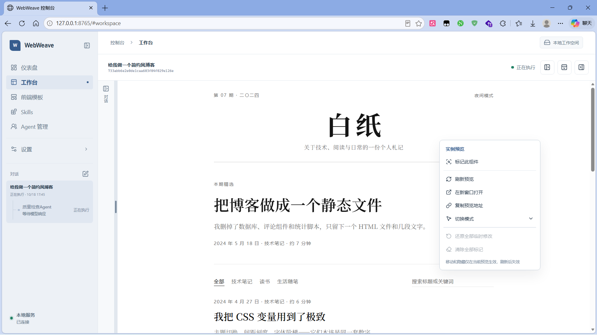

### 生成文件：找到网页源码和启动文件

“文件”页签按上传资料、生成结果和下载内容分类展示文件。网页源码与启动文件保存在生成结果中，可以查看后继续修改或自行运行。

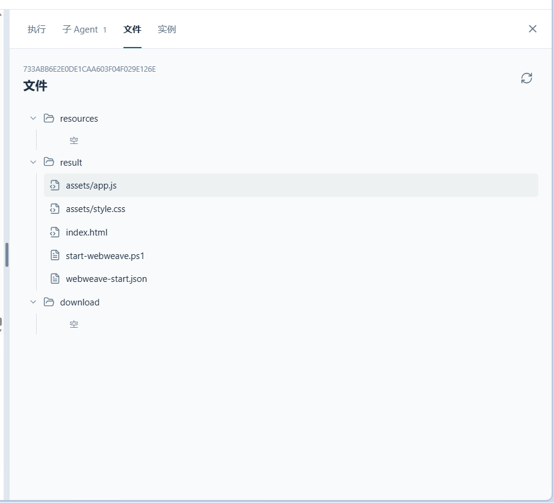

### 前端模板：保存可重复使用的作品

在“前端模板”页面点击“创建模板”，开启专用制作对话。完成后检查效果并确认保存，作品就会出现在模板库中。

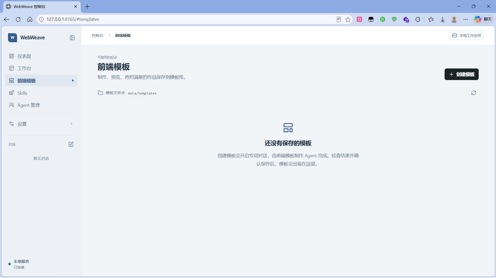

### Skills：查看可用的制作规则

Skills 页面展示本地已安装的能力及用途，方便了解当前工作台可以使用哪些制作规范和工作流程。

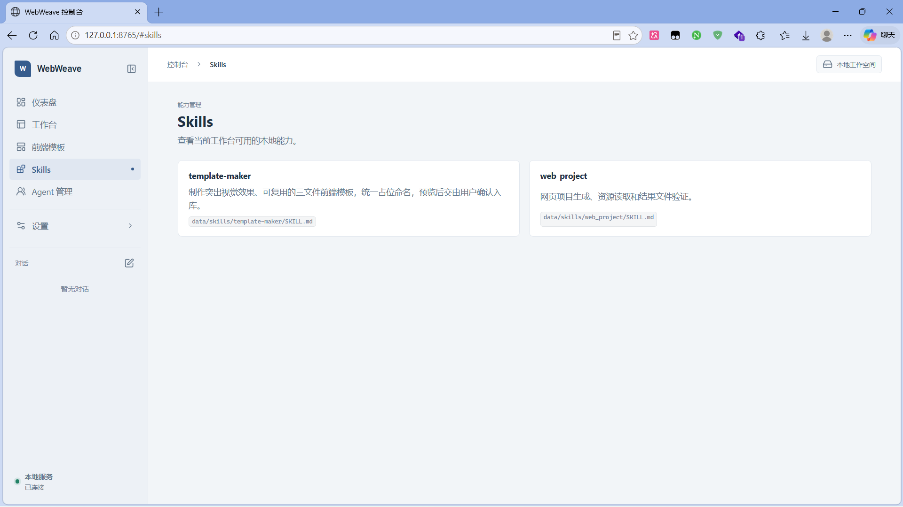

### Agent 管理：调整制作团队

查看各角色的职责，编辑角色指令，或添加自己的 Agent。子 Agent 可以跟随主模型，也可以选择单独的模型。

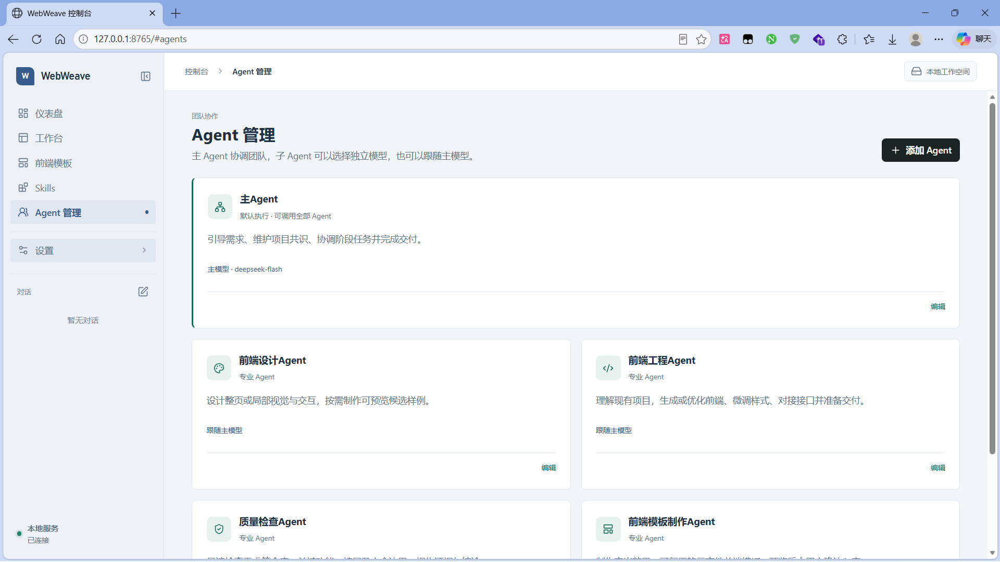

## 安装与启动

### 准备环境

- Go 1.26 或更高版本，以及用于获取项目的 Git。
- 支持 **Responses API 和工具调用**的模型服务，以及对应的 API Key。仅支持其他 OpenAI 接口的服务不一定能直接使用。
- PowerShell：Windows 可使用内置版本；Linux 和 macOS 需要安装 `pwsh`，供命令执行和网页预览启动使用。
- 生成项目所需的运行环境。例如，需要 Node.js 或 Python 的项目，应另行安装对应环境。

### 1. 获取并启动

以下命令在 PowerShell 中运行：

```powershell
git clone https://github.com/Gong-Yie/WebWeave.git
cd WebWeave
go mod download
if (-not (Test-Path config.json)) {
    Copy-Item config.json.example config.json
}
go run .
```

保持终端运行，在浏览器中打开 [WebWeave 工作台](http://127.0.0.1:8765)。服务只监听本机地址 `127.0.0.1`。

已有项目时，在项目目录运行 `go run .` 即可启动，不需要重新复制配置。

### 2. 连接模型

打开左侧的“模型配置”：

1. 添加模型，填写服务商提供的 **Base URL、API Key 和 Model name**。也可以使用“识别模型列表”导入可用模型。
2. 选择要使用的主模型。
3. 点击“保存配置”，再开始对话。

如果模型识别失败，可以手动填写模型名称。识别出模型列表不代表该模型一定支持网页制作所需的接口能力。

需要识别参考图时，主模型应支持图片输入，或在该页面配置独立视觉模型。思考强度等高级选项应按模型服务实际支持的能力设置。

### 3. 制作第一个网页

点击“新建对话”，描述你的想法，例如：

> 帮我做一个科技风的中文博客，使用深蓝黑色背景和青色点缀。先做单页，包含文章列表、标签筛选、文章详情和关于我，适配手机。请先和我确认视觉方案，再开始制作。

你也可以通过附件按钮上传参考图或需求文档。AI 会根据任务提出必要问题，确认范围和视觉方向，再推进页面制作。

生成过程中可以查看执行状态；有可用预览后，在右侧“实例”面板检查效果，并在同一对话中继续提出修改要求。

## 日常使用

### 给页面提出具体修改

在实例面板切换到“组件选择”或“定点评价”，选中要调整的内容。把标记拖入输入区，或点击“全部加入”，再说明修改要求，例如：

> 把这张卡片的标题缩小一点，增加正文行距，其他区域保持现状。

预览区的右键菜单还支持临时移动、隐藏组件和复制定位信息。临时移动、隐藏只用于比较效果，刷新后会恢复；要保存修改，请将要求发给 AI。

### 停止、继续与恢复任务

可以随时停止当前任务，之后点击“继续”。关闭浏览器不会结束仍在运行的后台任务；如果程序已经退出，重新启动后可打开历史对话继续未完成的工作。

较长任务会自动整理历史内容，并保存已确认需求、进度和未完成事项。达到单段执行预算后会保存进度并继续；如果持续没有有效进展，会暂停并说明原因。

出现方案确认时，使用决策卡片中的选项或“确认并继续”操作。如果系统无法判断中断前某个操作是否成功，会先请你核对，再决定是否重试。

交付结果会说明已完成内容、检查结论和仍存在的限制。已披露、由你明确接受的非阻塞限制可以保留为备注；尚未解决的阻塞问题仍需处理。

### 管理网页预览

同一对话可以打开多个预览实例，并通过标签切换。实例面板支持刷新、重启、停止、新窗口打开和删除当前实例。

任务结束后，可用“手动启动”重新启动预览；已有实例时，“新开实例”会增加一个独立预览。若提示缺少启动配置，可以在对话中请 AI 补齐网页的启动方式。

删除预览实例会移除其标签和实例记录，生成文件仍会保留。

### 找到并运行成品

生成项目默认保存在 `data/result/{运行ID}`，也可以从当前对话的“文件”面板查看。

任务结束时会在该结果目录生成启动文件。需要离开工作台运行时，在对应结果目录打开 PowerShell：

```powershell
& .\start-webweave.ps1
```

也可以指定端口：

```powershell
& .\start-webweave.ps1 -Port 3000
```

启动前应安装该项目需要的运行环境。脚本启动的网页可用 `Ctrl+C` 停止。

### 使用 Agent 与 Skills

通常保留默认主 Agent 即可，由它协调设计、工程和质量检查。需要直接完成某类任务时，可以从输入框下方切换执行角色；在“Agent 管理”中可以编辑角色指令和添加自定义角色。

Skills 用于保存可重复使用的制作规则，例如品牌配色、页面风格或内容规范。可在左侧 Skills 页面查看已安装内容。添加自己的 Skill 时，在 `data/skills/{名称}/SKILL.md` 中填写名称、用途和工作要求，例如：

```markdown
---
name: brand-style
description: 制作符合个人品牌风格的网页。
---

使用深蓝色背景和青色强调色。
正文使用中文，保持清晰的标题层级。
页面需要适配手机。
```

保存后刷新 Skills 页面即可查看，也可以在对话中告诉 AI 使用该 Skill。

### 制作前端模板

进入“前端模板”，点击“创建模板”，描述想要的布局和风格。模板使用占位文字，便于之后替换内容。

制作结束后先检查预览和文件，再点击“保存到模板库”并确认。保存的是独立副本，后续删除制作对话不会删除已入库的模板。

### 调整运行与外观设置

| 入口 | 可以调整的内容 |
| --- | --- |
| 模型配置 | 模型服务、主模型、可选视觉模型和模型高级选项 |
| 运行配置 | 流式输出、工具开关、超时、上下文压缩及摘要模型 |
| 外观设置 | 主题与背景图 |
| Agent 管理 | 角色指令、自定义角色和角色使用的模型 |

一般使用默认运行配置即可。上下文压缩可以单独指定摘要模型；可选的本地资料压缩需要额外准备 Python 环境和模型，默认关闭，不影响基本使用。

配置保存在本机的 `config.json`，在界面保存后生效。API Key 在界面中以掩码显示，请妥善保管配置文件。

## 常见问题

### 默认端口被占用怎么办？

在项目目录使用其他端口启动，然后打开对应地址：

```powershell
go run . --port 8877
```

此时访问 [http://127.0.0.1:8877](http://127.0.0.1:8877)。

### 更新项目后，为什么仍是旧版本？

拉取更新后需要重启程序。如果使用编译后的程序启动，还需要重新构建。Windows 下可在项目目录执行：

```powershell
go build -o webweave.exe .
.\webweave.exe
```

构建前先停止旧程序。使用 `go run .` 启动时，停止后重新运行即可。

### 模型连接失败或预览打不开怎么办？

模型连接失败时，先检查 Base URL、API Key、模型名称，以及服务是否支持 Responses API 和工具调用。仅在服务支持时开启思考摘要等高级能力。

预览打不开时，查看实例状态和执行记录，确认项目所需环境已安装、启动命令有效。也可以把错误信息发回当前对话，请 AI 根据已有项目排查。

### 删除对话会同时删除网页吗？

删除对话记录会保留附件、下载资料和生成文件。需要清理这些文件时，应另行确认并处理对应目录。

### 数据保存在哪里？

配置、对话记录、附件和生成文件保存在本机。使用远程模型或搜索服务时，相关请求内容仍会发送到对应服务；本地保存不等于离线推理。

## 反馈与许可证

遇到问题或希望增加功能，可以提交 [Issue](https://github.com/Gong-Yie/WebWeave/issues)，说明操作步骤、错误信息和预期结果。附图或日志前请移除 API Key 等敏感内容。

WebWeave 采用 [Apache License 2.0](LICENSE) 开源。使用、修改和再分发时，请保留许可证及相关版权声明。
