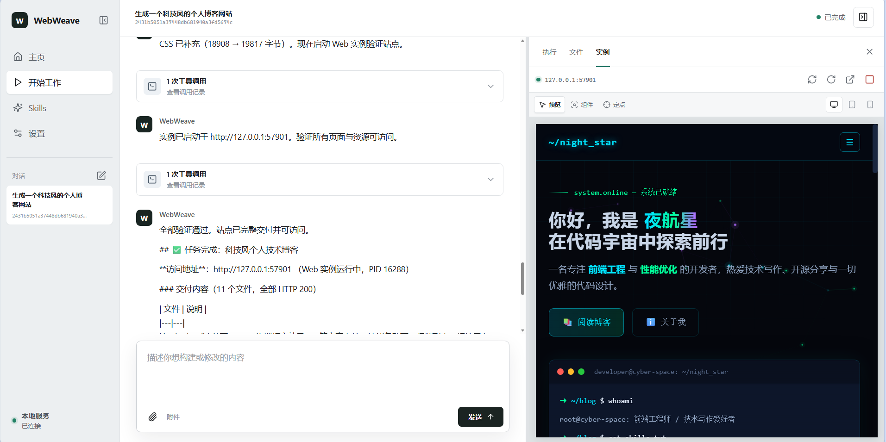
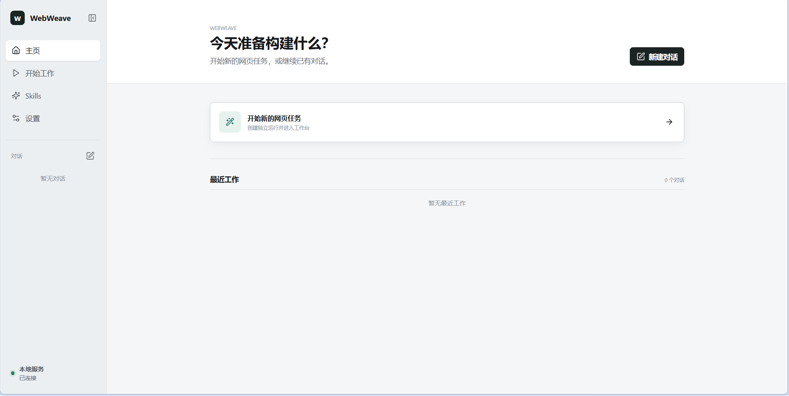
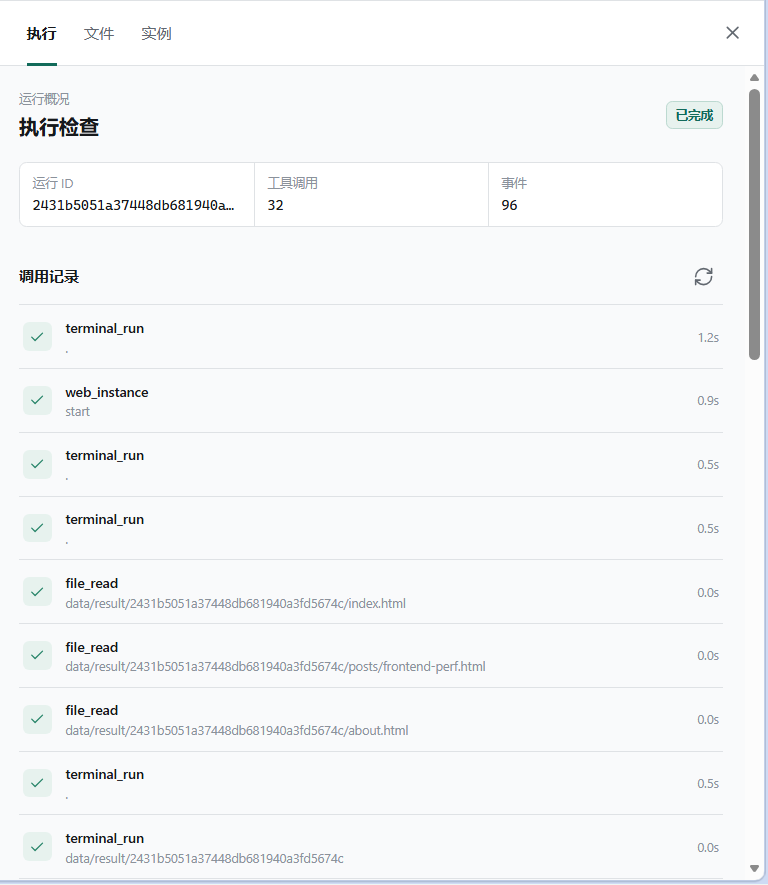
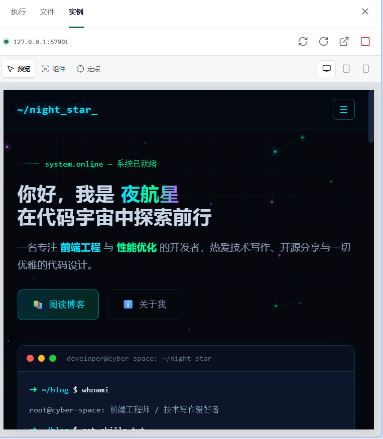
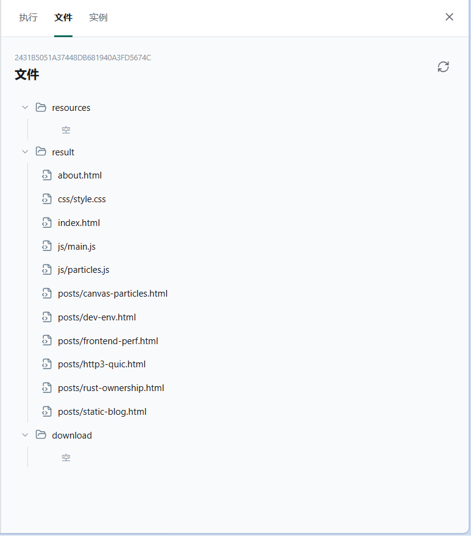

# WebWeave

> **WebWeave** - 让网页生成变得简单高效！

[](https://go.dev/)
[](https://developers.openai.com/api/reference/go)
[](LICENSE)

## 项目简介

WebWeave 是一个本地运行的智能网页生成工作台。用户只需要用自然语言描述目标，Agent 就会完成需求理解、资料检索、文件生成、命令执行和网页实例预览，并把每一步过程保存在独立的对话运行目录中。

WebWeave 采用 OpenAI 兼容的 Responses API。它适合快速生成网页原型、个人网站、博客、后台页面和交互式前端项目，也适合作为可扩展的本地 Agent 基础工程。

## 技术栈

| 层次 | 技术 | 用途 |
| --- | --- | --- |
| 运行时 | Go 1.26+ | Agent、WebUI 服务和工具执行 |
| 大模型 | 官方 OpenAI Go SDK v3、Responses API | 主模型推理、流式输出和工具调用 |
| 兼容服务 | OpenAI 兼容接口 | 可连接 DeepSeek 或其他兼容服务 |
| 后端 | Go 标准库 `net/http`、`httputil.ReverseProxy` | 本地 HTTP API、静态文件服务和 HTTP/WebSocket 预览代理 |
| 前端 | HTML、CSS、原生 JavaScript | 无构建步骤的工作台界面 |
| 图标 | Lucide | 导航、工具栏和状态图标 |
| Skill | YAML front matter、`go.yaml.in/yaml/v3` | Skill 发现、校验和读取 |
| 持久化 | JSON、JSONL、本地文件目录 | 配置、运行状态、事件、上下文和生成结果 |

## 效果展示

### 完整工作台

工作台同时展示对话过程、工具调用和生成网页实例，用户可以在一次对话中完成生成、验证和修改。



### 控制台与任务入口

控制台采用左侧导航、右侧内容的布局。仪表盘展示全部对话、执行中、已完成和失败任务的实时统计、任务状态分布，以及当前模型、工具和 Skills 概览，并提供新建对话和最近工作入口。历史对话可以从左侧导航继续打开或删除。



### 工具调用状态

执行检查区会记录每次工具调用、耗时、运行状态和事件数量，便于定位生成过程中的问题。



### 生成实例预览

生成结果可以直接在 WebUI 的实例面板中预览，并支持预览、组件选择、定点评价和设备尺寸切换。



### 运行文件树

每个对话拥有隔离的资源、结果和下载目录，文件可以在 WebUI 中查看、预览和复制。



## 项目结构

```text
WebWeave/
├── main.go                       # WebUI 与命令行启动入口
├── core/                         # Agent 与应用核心
│   ├── app.go                    # 后台任务、停止和继续
│   ├── agent.go                  # Responses Agent、视觉模型、上下文压缩
│   ├── config.go                 # config.json 热加载、校验及密钥掩码
│   ├── http.go                   # 前端 API、上传、文件预览和背景图
│   ├── instance.go               # Web 实例生命周期与健康检查
│   ├── paths.go                  # 当前应用的运行目录入口
│   ├── preview.go                # HTTP/WebSocket 预览代理
│   ├── preview_bridge.js         # 组件选择与定点评价桥接
│   ├── preview_bridge.css        # 预览检查样式
│   ├── store.go                  # JSON/JSONL 状态、事件与上下文
│   ├── tools.go                  # 将当前配置交给工具执行器
│   ├── cli.go                    # 命令行对话
│   └── webweave_test.go           # 隔离目录与本地假服务行为测试
├── tools/                        # Agent 工具模块
│   ├── registry.go               # 工具定义、参数、启用状态与超时分发
│   ├── files.go                  # 当前运行内的文件读写
│   ├── search.go                 # 网页检索与文件下载
│   ├── terminal.go               # 终端工具的前台与后台执行
│   ├── process*.go               # PowerShell 与跨平台进程树管理
│   └── *_test.go                 # 文件隔离、检索下载与终端测试
├── skills/
│   └── loader.go                 # YAML Skill 发现、校验与读取
├── workspace/
│   └── paths.go                  # 共享路径边界、运行目录与原子写入
├── webui/                        # 原生 HTML/CSS/JavaScript 工作台
│   ├── index.html
│   ├── app.js
│   └── styles.css
├── data/
│   ├── background/               # WebUI 背景图
│   ├── download/{运行ID}/        # 当前运行下载的资料
│   ├── resources/{运行ID}/       # 当前运行上传的附件
│   ├── result/{运行ID}/          # Agent 生成的项目文件
│   ├── run/{运行ID}/             # 事件、状态和上下文快照
│   └── skills/{名称}/SKILL.md    # 本地 Skill 内容
├── assert/                       # README 效果截图
├── config.json                   # 本地运行配置
├── config.json.example           # 配置模板
├── go.mod                        # Go 模块及依赖版本
├── go.sum                        # Go 依赖校验
├── LICENSE                       # Apache 2.0 许可证
└── README.md
```

## 主要功能

### 1. 自然语言网页生成

Agent 使用 ReAct 循环理解需求，并按需调用工具完成任务。每轮模型响应都可以继续读取工具结果，直到生成结果或向用户询问必要信息。

系统默认提供主Agent、网站灵感设计Agent、代码编程Agent、代码审计Agent和前端模板制作Agent。在左侧“Agent 管理”中可编辑角色指令、添加自定义 Agent 和删除自定义 Agent。主 Agent 使用模型配置页选择的主模型；子 Agent 的 `model_id` 留空时继承主模型，也可以选择模型列表中的独立配置。定义保存在 `config.json` 的 `agents` 数组。旧配置会自动补充前端模板制作 Agent，保留已编辑的角色及自定义 Agent。

工作台输入框下方的下拉框默认选择主Agent，可以切换本次任务的执行 Agent。重新打开对话会恢复上次执行的 Agent，停止后继续也会保留选择。主 Agent 可通过 `call_agent` 调用所有专业及自定义 Agent；每次委派都是具有独立 ID 和上下文的子 Agent 任务，共享当前运行的文件目录，结果返回主 Agent 后由它继续处理。主对话只展示委派入口，子 Agent 的任务、思考、工具调用和回复在右侧“子 Agent”页签内按每次委派分开展示；点击主对话的委派卡片或历史侧栏的子 Agent 可打开对应会话，运行中的新委派会自动展开。会话支持切换查看，重新打开历史对话时恢复记录，并显示完成、失败或中断状态。对话与工具记录显示实际执行的 Agent。默认 Agent 可以编辑，不能删除。

当前内置工具包括：

- `list_skills`、`read_skill`：发现并读取本地 Skill
- `web_search`：检索网页资料并下载文件
- `file_read`、`create_file`：读取输入和生成结果文件
- `read_context_segment`：按片段 ID 和字符偏移回读已压缩记录的原文
- `terminal_run`：在当前运行目录执行 PowerShell 命令
- `web_instance`：启动、查看、停止和重启生成的网页实例

工具可以在 `config.json` 中独立启用、禁用和设置运行隔离。文件、下载、终端和实例工具需要启用 `run_scoped` 才能访问当前运行目录。搜索与下载直接使用 Go HTTP 客户端，无需安装 curl。

### 2. 对话运行隔离

网页生成优先交付可预览的完整首版；未明确要求多页面时，先完成单页网站。设计方案保持简明，审计只检查影响使用的缺陷，避免反复验证和扩展任务。每次执行的工具轮次预算为：主 Agent 24 轮、设计 Agent 8 轮、审计 Agent 12 轮、编程和自定义 Agent 48 轮。达到预算后会请求一次不调用工具的收尾响应，说明已完成与未完成事项；预算按每次消息或委派计算，不是完成时间保证。

每个对话都有唯一运行 ID，输入资源、生成结果、下载文件、事件日志、状态和上下文互相隔离。对话支持：

- 流式显示模型输出
- 折叠展示模型接口返回的思考文本或摘要，支持流式更新和历史恢复；接口没有返回时只展示真实执行状态
- 协作式停止和停止后继续
- 历史记录重新打开
- 对话记录删除（保留附件、下载及生成文件，与原后端行为一致）
- 运行事件和工具调用追踪

### 3. 可选视觉模型

图片附件可以直接交给主模型，也可以启用独立视觉模型先生成文字描述，再交给主模型处理：

- `llm.vision.enabled=false`：主模型直接识别图片
- `llm.vision.enabled=true`：视觉模型负责图片转文字，主模型负责任务推理
- 视觉模型调用失败时，会回退为主模型的多模态输入

### 4. 生成实例与检查

Agent 生成网页后，可以通过实例面板直接查看本地预览。检查区提供：

- 预览、组件多选和定点评价模式；组件和定点保留独立编号标记，可将预览标记或已选卡片拖入对话输入区，也可点击“全部加入”。输入区及发送后的消息以完整卡片展示，逐个移除不会改写正文；定位信息随 `instance_context` 发送给 Agent
- 桌面、平板和手机尺寸切换
- 同源 HTTP/WebSocket 预览代理
- 实例刷新、重启、停止、删除和新窗口打开
- 同一对话可同时运行多个实例，在实例页顶部的标签间切换；每个实例拥有独立进程、端口、日志和预览地址

工作台中间的分隔线支持左右拖动，向左拖到边缘可隐藏对话，让预览占满剩余空间；点击左侧“对话”窄栏或顶部“展开对话”按钮可恢复。顶部还可以独立隐藏整个检查区，或在“实例”页隐藏标签和预览工具栏，为网页留出更多高度；同一按钮可恢复显示。分隔线支持方向键调整，Home 隐藏对话，End 隐藏检查区。窄屏使用顶部按钮切换面板。

每次任务结束（包括失败或停止）都会在当前运行的 `data/result/{运行ID}` 根目录生成 `webweave-start.json` 和 `start-webweave.ps1`。Agent 通过 `web_instance start` 显式启动时会自动保存启动参数；未自动启动时，Agent 应提供以下启动配置，`cwd` 相对于当前 result 目录，`command` 必须包含 `{host}` 和 `{port}`：

```json
{"command":"python -m http.server {port} --bind {host}","cwd":".","port":0,"health_path":"/"}
```

上例用于已安装 Python 的静态网页，动态项目应使用自身的启动命令。实例页的“手动启动 / 新开实例”按钮读取启动配置并新增独立实例，保留已运行实例。停止和重启仅作用于当前选中的实例；停止后的实例可通过重启按钮再次运行。Agent 调用 `web_instance start` 时省略 `instance_id` 新开实例，提供 `instance_id` 则启动该已停止实例；`status` 返回 `instances` 列表，`stop` / `restart` 应携带目标 `instance_id`，省略时兼容操作最近新建的实例。多个实例应使用 `port=0` 自动分配端口，固定端口被占用时会报错。

旧的单实例记录和 `/preview/{运行ID}/` 地址继续兼容，新实例预览地址携带实例 ID，防止切换实例后旧预览指向其他进程。历史实例首次手动启动时从原实例记录补齐启动文件；尚无启动命令的任务会明确提示补齐配置，不会猜测启动方式。启动文件位于 result 根目录，不改变模板子目录的三文件约束。

“删除当前实例”在确认后先停止该实例，再移除实例记录和标签；其他实例、生成文件、日志和启动配置保留。删除后自动切换到剩余实例，没有剩余实例时显示空状态。删除接口沿用 `POST /api/runs/{run_id}/instance`，传入 `action: "delete"` 和必填的 `instance_id`。

也可以在该运行的 result 根目录自行执行（脚本直接运行项目，不注册到 WebUI；可用 Ctrl+C 停止）：

```powershell
& .\start-webweave.ps1
# 可选：指定端口；默认按配置启动，port=0 自动分配本机端口。
& .\start-webweave.ps1 -Port 3000
```

### 5. 文件树与结果预览

文件面板会按 `resources`、`result` 和 `download` 展示运行目录，支持文本预览、图片预览和内容复制。生成项目默认写入 `data/result/{运行ID}`。

### 6. 设置、主题和 Skill 管理

左侧导航提供运行配置、模型配置和外观设置三个独立入口：

- 运行时模型、工具、超时和上下文压缩配置
- 主模型和可选视觉模型配置
- 主题切换和背景图上传
- API Key 在界面中以 `********` 掩码显示
- 左侧 Skills 页面展示 `data/skills` 下可用 Skill

背景图会保存到 `data/background`，不需要额外的静态资源构建步骤。

### 7. 上下文压缩与热加载

上下文采用分层压缩：当前需求与近期完整交互原样保留，较旧的大型观察和已成功写入的大型源码保存到 `data/run/{运行ID}/context_segments/{内容哈希}.json`。模型预览保留文件路径、退出码等精确字段，并提供原文片段 ID；需要精确内容时用 `read_context_segment`，通过 `offset`、`max_chars` 分页回读。重复内容复用已保存的压缩结果，内容、模型或保留比例变化后重新压缩。源码和失败命令的关键异常不进入 Token 删除模型。

可选的 `context.local_compression` 使用常驻 Python 进程运行 LLMLingua-2。只压缩旧的 `.md`、`.txt` 文件内容和搜索结果中的标题、摘要；JSON 外壳、源码及精确工具字段不进入压缩器。Markdown 围栏代码块及包含数字、链接、源码文件名或明确否定/约束词的文本行保持原样。无法缩减的受保护内容保持原文并记录 `context_segment_compression_skipped`；本地压缩失败则记录 `context_segment_compression_failed`，同次执行不再重试本地模型。完整工具结果同时保留在 `events.jsonl`。

任务记忆由独立的摘要请求维护。`summary_model_id` 可选择模型列表中的独立模型，留空时跟随当前 Agent；DeepSeek 摘要请求显式使用 `reasoning.effort=none`，并通过 JSON Schema 约束输出。默认每批输入预算 `summary_input_tokens=8192`、输出预算 `summary_max_tokens=4096`。完整工具交互优先保持在同一批，超大轮次按连续片段处理，不删除中间记录；每批携带上一批摘要。摘要读取原始资料，避免对 LLMLingua 的有损结果再次总结；大型源码和旧的成功终端输出以原文引用代替，失败证据仍保留。

摘要失败不裁剪历史，也不替换已有摘要；`context_compression_failed` 记录阶段、错误、已完成批次数，以及接口返回的状态、未完成原因和输出 Token 用量。同次消息或委派中，失败后不再逐轮重试摘要；输入估算未超过 `max_input_tokens` 时保留原上下文继续，超过预算则明确结束执行。调整模型或压缩配置后可继续。既有运行记录格式仍兼容。

配置模板的 `context.max_input_tokens` 为 65,536。输入框下面的圆环显示最近一次模型请求的输入 Token 与压缩阈值（`max_input_tokens × compression_trigger_ratio`），包括子 Agent 请求，并在提示中标明执行者。接口返回 `usage.input_tokens` 时显示 API 值，否则显示包含对话、角色指令及工具定义的估算值。压缩触发和输入预算检查同样包含对话、角色指令及工具定义；图片及供应商分词差异使估算值不能作为精确计费依据。`file_read` 的普通相对路径默认指向当前运行的 result 目录，也支持显式 scope、项目 `data` 路径和允许的绝对路径。

本地压缩默认关闭，不影响仅安装 Go 的启动方式。Windows GPU 环境可在项目根目录安装专用虚拟环境（以下 CUDA 12.8 组合已在 RTX 4060 Laptop 上验证）：

```powershell
python -m venv compression/.venv
& compression/.venv/Scripts/python.exe -m pip install 'torch==2.11.0+cu128' --index-url https://download.pytorch.org/whl/cu128
& compression/.venv/Scripts/python.exe -m pip install -r compression/requirements.txt
& compression/.venv/Scripts/python.exe -X utf8 compression/evaluate.py --output data/compression/evaluation.json
```

首次评测会下载模型权重。准备完成后在“运行配置”启用本地资料压缩，默认使用 `microsoft/llmlingua-2-xlm-roberta-large-meetingbank`、`cuda` 和 0.7 保留比例；CPU 或其他操作系统需调整设备和 Python 路径。应用按需启动进程并在退出时清理，诊断日志位于 `data/compression/worker.log`。模型和虚拟环境不进入版本控制。评测报告的 Token 计数使用 `cl100k_base` 作为代理，不等同于 DeepSeek 计费；固定中英文样例用于检查缩减和精确字段保留，不代表长任务成功率。

回归测试：

```powershell
go test ./...
& compression/.venv/Scripts/python.exe -m unittest discover -s compression -p 'test_*.py'
```

离线压缩评测报告写入 `data/compression`，不进入版本控制，也不代表完整网页任务完成率。

### 前端模板库

左侧“前端模板”页面的“创建模板”按钮会进入工作台，创建并持久化选择前端模板制作 Agent 的新对话。系统在该 Agent 执行前默认加载 `template-maker` Skill，无需用户额外指定或由模型主动读取。标题统一为“标题”+数字 id，正文统一为“文本”+数字 id，其他命名组件统一为“组件”+数字 id，重点突出效果和可复用性。源码位于当前对话的 `result/{模板名}` 文件夹，固定且仅有 `index.html`、`style.css` 和 `script.js`，HTML 引用同目录 CSS/JS；启动和替换说明直接在对话中交付。

任务完成后，输入框上方显示模板名称和“保存到模板库”按钮。检查预览及文件后点击按钮并确认，复制为 `data/templates/{模板名}` 中的独立快照；该文件夹仍只有三个文件，元数据单独存入 `data/templates/.metadata/{模板ID}.json`。入库检查三文件结构、占位文字、组件命名、重复 id 和 CSS/JS 引用，拒绝同名覆盖、非法目录名、符号链接、非普通文件和超过 100 MB 的模板。已有旧格式模板继续列出，不自动改写。删除制作对话不会删除已保存的模板。

上下文达到 `config.json` 中的阈值后，Agent 会生成摘要并保留最近项目，降低长对话的输入成本。配置文件与 `data/skills` 中的 SKILL 文件支持运行时重新读取。工具定义和分发位于 `tools/registry.go`，文件、搜索与终端实现分别位于对应模块文件；修改 Go 源码后需要重新编译或重新执行 `go run`。

代码依赖方向为 `main → core → tools / skills / workspace`，`tools` 依赖 `skills` 和 `workspace`，`skills` 依赖 `workspace`。工具通过应用注入的回调执行实例操作，不导入 `core`，避免循环依赖。`skills/` 保存加载器源码，`data/skills/` 保存用户的 SKILL 文档。

### 8. 从 Python 后端迁移

后端由 Go 运行；启用可选的 LLMLingua-2 本地资料压缩时需要专用 Python 环境。已有 `config.json`、`data/run/{运行ID}/state.json`、`events.jsonl`、`context.json` 和资源目录可继续使用，前端 API 路径保持一致。停止旧 Python 后端服务后再启动 Go 服务，以避免端口占用和两个进程同时修改运行数据。

旧对话恢复时会移除未配对的工具调用与结果。已经退出的历史实例需要重新启动；如果原启动命令本身使用 Python，则该生成项目仍需要 Python，这与 WebWeave 后端运行时无关。

## 安装指南

### 环境要求

- Go 1.26 或更高版本
- 一个 OpenAI 兼容的大模型服务和 API Key
- Windows、Linux 或 macOS；终端工具和实例启动需要 PowerShell（Windows 内置 PowerShell 或安装 `pwsh`）

### 1. 获取项目

```bash
git clone https://github.com/Gong-Yie/WebWeave.git
cd WebWeave
```

### 2. 下载依赖

```powershell
go mod download
```

### 3. 配置大模型

首次安装且项目根目录没有 `config.json` 时，可以复制配置模板：

```powershell
Copy-Item config.json.example config.json
```

编辑 `config.json` 的 `llm` 节点：

```json
{
  "llm": {
    "models": [
      {
        "id": "main-model",
        "model": "your-main-model",
        "base_url": "https://api.example.com/v1",
        "api_key": "your-main-api-key"
      }
    ],
    "main_model_id": "main-model",
    "vision": { "enabled": false }
  }
}
```

`llm.models` 保存模型列表，`main_model_id` 选择主模型，`vision_model_id` 选择可选视觉模型。旧的 `llm.main` 和 `llm.vision` 配置继续兼容；首次在新界面保存后会使用模型列表，后端同时保留角色镜像。LLM 配置统一保存在 `config.json`，不从 `.env` 读取。请勿将真实 API Key 提交到 Git 仓库。

模型配置页采用列表：添加模型后填写 Base URL、Model name 和 API Key；填写地址和 Key 后可点击“识别模型列表”，通过该地址下的 `/models` 读取可用模型，勾选后“一键导入所选模型”。列表编辑及导入先更新页面草稿，点击右上角“保存配置”持久化并应用。识别失败时可直接手动填写 Model name。

高级项默认收起，没有自定义 Headers 或思考强度设置。展开后可添加 `headers` 键值对，并声明模型实际支持的 `reasoning_efforts` 档位及默认 `reasoning_effort`。API Key 和 Header 值在返回配置时掩码，按稳定模型 ID 保留。模型识别不会推断思考能力；各接口、模型支持的档位应以实际接口为准。

支持思考强度的模型会在对话输入区显示档位选择。留空使用该模型配置的默认档位，没有默认配置时省略 `reasoning.effort`；明确选择的档位会保存到对话，停止后继续保留。主 Agent 的对话覆盖只作用于当前执行者，委派的子 Agent 使用其自身模型默认档位。未声明支持的模型不显示选择器，也不接受强度覆盖。模型列表、消息、继续接口和 Agent 编辑都会校验引用及档位。

其他运行参数包括：

- `model.stream`：是否流式输出
- `model.reasoning_summary`：是否发送 `reasoning.summary=auto` 请求思考摘要，默认关闭以保持兼容；在运行配置中仅为支持该参数的模型开启。接口主动返回的思考文本和摘要无需打开此开关即可显示
- `tools.<name>.enabled`：是否向模型暴露工具
- `tools.<name>.run_scoped`：是否允许工具访问当前运行的隔离目录
- `tool_timeout`：工具默认和最大超时
- `context`：上下文压缩开关、阈值和保留项目数

也可以直接在 WebUI 左侧的“模型配置”和“运行配置”页面修改，配置会被校验并原子写入。

模型连接遇到超时、连接中断、限流或服务端错误时会自动重试，最多 5 次；请求参数错误不会重试。

WebUI 设置页不内置模型、超时或工具开关的运行参数；配置控件在成功读取当前 `config.json` 后才启用，保存内容由该配置文件统一管理。

## 使用方法

### 1. 启动 WebUI

```powershell
go run .
```

默认地址为：

<http://127.0.0.1:8765>

自定义端口：

```powershell
go run . --host 127.0.0.1 --port 8765
```

服务默认只监听本机地址，适合本地使用。启动后在浏览器打开地址即可进入 WebWeave 工作台。

也可以构建后启动（Windows PowerShell）：

```powershell
go build -o webweave.exe .
.\webweave.exe
```

从其他目录运行时，使用 `--root` 指定包含 `webui`、`config.json` 和 `data` 的项目根目录。Linux/macOS 构建时可使用 `go build -o webweave .`。

命令行对话及恢复已有对话：

```powershell
go run . --cli
go run . --cli --run-id 现有运行ID
```

### 2. 完成一次网页任务

1. 点击“新建对话”，或进入左侧“工作台”后点击空页面上的“创建新对话”。工作台导航只切换页面，不创建对话；已有活动对话会保留。
2. 描述网页目标、页面结构、视觉风格和交互要求。
3. 通过附件按钮上传参考图、需求文档或其他资源。
4. 观察对话区和执行检查区中的工具调用过程。
5. 在“实例”面板预览生成结果，必要时使用组件选择或定点评价。
6. 在同一对话中继续提出修改要求，Agent 会使用已有上下文继续工作。
7. 在“文件”面板检查生成文件，最终项目位于 `data/result/{运行ID}`。

### 3. 使用 Skills

在 `data/skills` 下新增一个目录，并创建带 front matter 的 `SKILL.md`：

```text
data/skills/my_skill/SKILL.md
```

```markdown
---
name: my_skill
description: 描述这个 Skill 解决什么问题。
---

# 使用说明

在这里写给 Agent 的具体工作规则、检查步骤和输出要求。
```

刷新 WebUI 的 Skills 页面后，Agent 也可以通过 `list_skills` 和 `read_skill` 发现并读取它。

### 4. 管理主题和背景图

进入左侧“外观设置”选择主题或上传 PNG、JPG、WebP 背景图。背景图会保存到 `data/background`，删除背景不会影响对话和生成结果。

### 5. 本地 API

WebUI 同时提供用于前端和自动化集成的本地 API：

| 方法 | 路径 | 作用 |
| --- | --- | --- |
| `GET` | `/api/health` | 检查服务状态 |
| `GET` / `PUT` | `/api/config` | 读取或保存运行配置 |
| `GET` | `/api/skills` | 获取本地 Skill 列表 |
| `GET` / `POST` | `/api/agents` | 列出 Agent 或添加自定义 Agent |
| `PUT` / `DELETE` | `/api/agents/{agent_id}` | 编辑 Agent 或删除自定义 Agent |
| `GET` / `POST` | `/api/runs` | 列出或创建对话 |
| `POST` | `/api/runs/{run_id}/instance` | `start` 读取项目启动文件；也支持 `status`、`stop`、`restart` |
| `GET` | `/api/templates` | 获取已确认入库的前端模板 |
| `POST` | `/api/models/discover` | 使用指定或已保存的接口凭据识别模型列表 |
| `POST` | `/api/runs/{run_id}/template` | 用户确认后保存已完成的模板，传入 `name` 和 `approved: true` |
| `DELETE` | `/api/runs/{run_id}` | 删除对话记录，保留资源与生成文件 |

`POST /api/runs` 可传入 `agent_id` 并持久化初始执行者，省略时使用主Agent。`POST /api/runs/{run_id}/messages` 支持 `agent_id` 和 `reasoning_effort`，省略 Agent 时使用主Agent。`POST /api/runs/{run_id}/continue` 可传入 `agent_id` 切换执行者和 `reasoning_effort` 覆盖档位，空请求体则沿用对话设置。对话详情的 `context_usage` 提供最近请求的 Token、估算标记和当前压缩阈值。子 Agent 生命周期及思考流保存在运行事件中。

## 贡献指南

欢迎通过 Issue、Pull Request 或 Skill 提交改进建议。建议遵循以下流程：

1. 先创建 Issue，说明问题、复现步骤或功能目标。
2. 从最新代码创建独立分支，保持一次提交只解决一个主题。
3. 修改前阅读相关模块和配置，尽量复用现有工具链和目录边界。
4. 新增行为时补充直接相关的测试或可复现验证步骤。
5. 提交前运行最小必要检查：

   ```powershell
   go test ./...
   ```

6. 不要提交真实 API Key、运行生成物、个人背景图或临时调试文件。
7. Pull Request 中请说明改动范围、验证命令和已知限制。

测试使用系统临时目录和本地假模型 HTTP 服务，不连接真实模型提供商。实例生命周期测试会通过 PowerShell 启动并清理本地测试服务。前端代码修改时另行执行 `node --check webui/app.js`。

## 许可证

WebWeave 采用 [Apache License 2.0](LICENSE) 开源。使用、修改和再分发本项目时，请保留许可证和相关版权声明。


---

**WebWeave** - 让网页生成变得简单高效！
